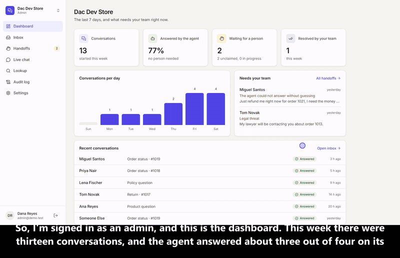

# shop-support-agent

[](https://github.com/Exalt24/shop-support-agent/actions/workflows/ci.yml)



*The console on a development store with sample customers. The full three minute walkthrough regenerates from [docs/demo-video.md](docs/demo-video.md).*

A customer-support agent for a Shopify store. It looks up orders and products through the Admin GraphQL API, answers from the store's own policy file, and hands anything it should not decide to a person. Built as a working proof of the first of the five agents in an e-commerce AI-agent brief: support.

**Register: built, tested and run live against a Shopify development store with sample customers. It runs locally, on one platform (Shopify).** The human handoff produces a ticket-shaped payload, and wiring it to a helpdesk is the next step. Enquiry routing, the chat widget, the Zoho MCP server and the Zia client are built and tested against stand-in servers written from the vendors' saved documentation pages (see their sections).

## What it does

`SupportAgent.handle(message, email)` runs in a fixed order, and the order is the design:

1. **Escalation floor first.** A legal threat, a chargeback, a safety report or a request for a person is matched in code before the model sees the message. The model also gets a vote (angry, wants a human), but it can only add escalations, never remove one.
2. **Triage** (the model): intent, order number, product query. It never sees order data.
3. **Facts** come from Shopify and `policy.md`, never from the model's memory. Orders are **identity-checked**: the email on the message must match the email on the order.
4. **The model writes the wording only.** A grounding guard refuses any reply containing a figure not in the facts (digits *and* numbers written as words), a commitment the agent has no authority to make (refund, discount, replacement), or an outcome the facts do not state ("the tracking details were emailed to you").
5. **Anything that fails ends in a person**: a store outage, a model outage, a reply that fails the guard twice. A failed lookup is never reported as "no such order".
6. **Every turn is logged** (`logs/audit.jsonl`): intent, order, decision, escalation reason, steps. Emails are masked.

## Proof

```
./.venv/Scripts/python.exe -m pytest tests -q              # 483 tests, offline (scripted model, stand-in shop, stand-in Zoho; the widget tests drive Chromium and skip without it)
./.venv/Scripts/python.exe tests/mutation_check.py         # 131 mutants: each guard broken on purpose
./.venv/Scripts/python.exe demo.py                         # nine messages, live store + live model
./.venv/Scripts/python.exe demo_memory.py                  # five turns with memory, live store + model + Postgres
./.venv/Scripts/python.exe demo_enquiry.py                 # five enquiries, scripted model + fake Zoho (no live anything)
./.venv/Scripts/python.exe demo_mcp.py                      # the MCP server over stdio against the fake Zoho
```

- **Mutation harness:** each of 131 guards (the original 11, 14 for customer memory, 40 for enquiry routing, lead capture and the Zoho client, 27 for the chat server and widget, 39 for the MCP tools, the Zoho reads and the Zia client) is deleted from the real source, the suite is run, and the file is restored byte-exact. All 131 mutants are caught. The identity check, the throttle-as-HTTP-200 handling, the legal-threat rule, the grounding guard, the number-word check and `status:active` product filtering each have a test that fails without them.
- **Live transcript:** `demo_transcript.md`. Nine messages including three hostile ones (a refund demand, a prompt injection asking for a 50% discount code, a legal threat). 7 answered, 2 escalated, and no promise, invented figure or foreign order detail reached a customer.
- **Through n8n:** `n8n/workflow.json` (webhook, agent, "needs a person?" branch, handoff ticket, reply) was imported into a real n8n 2.41.6 server, published, and called over its webhook with an answered message, a wrong-email message and a legal threat. Regenerate it with `python n8n/build_workflow.py`.

## Customer memory

The agent remembers returning customers, and the design is about what memory is **not** allowed to do: it never supplies a fact (orders, prices and tracking are read live every turn), it stores one verified pointer to the last order, notes go stale, and only the customer's own words are kept. Isolation is forced row level security per store, and staff can read and erase notes. The rules, the proof commands and the live run are in [docs/customer-memory.md](docs/customer-memory.md).

## Enquiry routing and Zoho CRM lead capture (tested against a stand-in Zoho)

For a sales site as well as a shop: the agent sorts each enquiry, routes it to an owner queue, and with the visitor's explicit yes puts it in Zoho CRM as a Lead, a follow-up Task and a Note. Details, field rules and the vendor citations are in `docs/enquiry-routing.md`; the Zoho pages it relies on are saved in `docs/vendor-contract/`.

- **Same order as above.** The escalation floor runs first. The model then only proposes an intent from a fixed list of seven; code checks it, anything unlisted becomes `human_needed`, and a routing table in code gives the owner queue and the follow-up. The model can add an escalation, never remove one.
- **Consent is code, not the model.** The agent asks once, in plain words, whether it may pass the visitor's details to the team. Only an explicit yes in the visitor's own message, after the question, counts ("yes but don't share my phone" does not).
- **A lead is only what the visitor wrote.** Name, email and phone are validated, a company is kept only if the visitor named it, card-like numbers and secrets are dropped, and a message with two different emails uses neither. The note is built by code from their words, shortened.
- **One lead per email per tenant per day.** A stable idempotency key stops a retried request from creating twice, and a second enquiry the same day adds a Note to the same lead. Nothing is captured on an escalated turn.
- **The CRM never changes the answer.** The reply is final before Zoho is called. A refusal is recorded with the vendor's code; 429 and 5xx are retried with backoff, an expired token is refreshed once. An Australian account is `ZOHO_REGION=au` (`accounts.zoho.com.au`, `www.zohoapis.com.au`).
- **The audit log holds counts and kinds** (intent, queue, consent yes or no, captured yes or no, vendor code), never the visitor's words or email.

```
./.venv/Scripts/python.exe -m pytest tests -q       # tests/test_enquiry.py, test_zoho_crm.py and test_leads_property.py (seeded random worlds with faults)
./.venv/Scripts/python.exe demo_enquiry.py          # transcript in demo_enquiry_transcript.md
```

**Scope and next steps.** Built and tested against a stand-in that follows the saved Zoho pages, so the next step is a run against a Zoho account to confirm every field name. One CRM. The ledger and dialogue state are in memory (one process). The Task owner is not set because no saved page names that key. Consent is an English-keyword check. `serve.py` has it (when `ZOHO_*` variables are set); the console does not.

## One chat widget for two websites, a Zoho MCP server and a Zia client (tested against stand-ins)

- **Widget.** One script tag (`data-site`) and vanilla JavaScript in a Shadow DOM, served by `serve.py` for several websites. Each site is a tenant with its own theme, greeting, allowed origins, routing table (quote requests go to `estimating` on one site and `trade-accounts` on the other) and Zoho settings. Guards: per-origin CORS, a site key that only selects the tenant, signed conversation ids, per-IP and per-conversation rate limits, size caps, text-only rendering, and yes and no buttons that send the same words the consent code already reads. Chromium tests drive both demo sites at 1280 and 360 pixels. [docs/chat-widget.md](docs/chat-widget.md)
- **MCP server.** Five tools over the lead desk and the Zoho client on the official `mcp` SDK, stdio: strict schemas, credentials from the environment only, `confirm` and an idempotency key on every write, small answers, CRM text returned as data. Zoho hosts its own MCP servers; this one adds tenant routing and consent. [docs/zoho-mcp.md](docs/zoho-mcp.md)
- **Zia Agents client.** The Agent API is documented enough (endpoint, headers, body, answer, OAuth), so a small client with a fake is built from the saved pages. Nothing else is guessed: no retries, no error shapes.

```
./.venv/Scripts/python.exe -m pytest tests/test_widget_browser.py tests/test_mcp_stdio.py -q   # Chromium and a child process
./.venv/Scripts/python.exe demo_widget.py                                                      # the two demo sites on :8101 and :8102
```

**Scope and next steps.** Tested against stand-in Zoho and Zia servers and the two demo sites. The widget runs locally from `serve.py`, has no analytics, and its limits and chats are held in memory. The MCP consent flag is the caller's statement. Zia is tested as a standalone client.

## What the live runs taught

The four things the live runs changed (stemming, active products only, unsupported outcomes, number words) are in [docs/live-runs.md](docs/live-runs.md).

## The support console (login, roles, many stores)

A web console around the same engine, so a team can use it and a new store is a new row rather than a new build. `console_api/` (FastAPI) holds the rules and `console_web/` (Next.js) is the screen.

- **Roles and stores.** Sign in with email and password. An **admin** sees everything for a store, plus the audit log and the policy editor. An **agent** sees the inbox, handoffs, live chat and lookup. One person can belong to several stores and switch between them. A store you do not belong to answers 404, never 403, so its existence is not confirmed.
- **Pages.** Dashboard, a three-pane inbox (list, thread, order and agent steps), a handoff queue with one owner per case (claim, reply, resolve), a live chat that talks to the real agent as a customer, order and product lookup, an admin audit log, and a policy editor. Every status is an icon plus a word. It works at phone width.
- **Isolation lives in the database.** One Postgres database, a `tenant_id` on every tenant table, row level security enabled and forced. The API connects as `console_app`, which is not a superuser, does not bypass row security and does not own the tables; startup refuses to serve otherwise. The tenant is bound per transaction. The audit log is append-only and admin-readable. The Shopify token is stored encrypted and is never sent to the browser.
- **Login.** bcrypt, a signed session cookie (httponly, SameSite=Lax), a lockout after five failures per ten minutes per email and address, and a CSRF guard on writes.

```
docker run -d --name support-console-pg -e POSTGRES_PASSWORD=localsuper -e POSTGRES_DB=console -p 54931:5432 postgres:17
./.venv/Scripts/python.exe -m console_api.migrate --reset        # schema, roles, forced RLS
./.venv/Scripts/python.exe -m console_api.seed                   # demo stores, two logins, a week of conversations
CONSOLE_ALLOWED_ORIGINS=http://localhost:3100 ./.venv/Scripts/python.exe -m uvicorn console_api.main:app --port 8010
cd console_web && npm install && npx next dev --port 3100        # then open http://localhost:3100
```

Demo logins (local only, written in `console_api/seed.py`): `admin@demo.test` / `demo-admin-pass` (both stores), `agent@demo.test` / `demo-agent-pass` (one store).

```
./.venv/Scripts/python.exe -m pytest tests_console -q             # 63 tests: isolation, roles, login, the API, customer memory
./.venv/Scripts/python.exe tests_console/mutation_check.py        # 22 mutants: each database rule broken on purpose
cd console_web && node tests/e2e.js                               # 37 browser checks at 1280 and 390, both roles
```

Run the engine and console suites as two commands, not one (two `conftest.py` files collide). The mutation harness rebuilds the local `console` database, so reseed afterwards and run it only against that local database.

**Before any real use:** `python -m console_api.seed --purge` removes every demo row, then set real passwords and connect a real store. The seed passwords are public in this file on purpose and must never reach a live database.

**Reusing it for another store:** insert a `tenants` row (slug, name, shop domain, encrypted token via `console_api/secrets_store.py`, policy markdown) and a `memberships` row per person. The engine reads that store's orders and policy; nothing else changes. A different shop platform means swapping `agent/shopify.py`, not the console.

## The demo video

How the three minute narrated walkthrough of the console is regenerated is in [docs/demo-video.md](docs/demo-video.md).

## Honest limits

- The console runs locally. Session lockout counters are in memory (one process).
- The guard checks figures, a list of commitment phrases and unsupported outcomes. It cannot judge every sentence; wording-level claims beyond those patterns rely on the prompt and on human review of escalations.
- Policy retrieval is word overlap over a handful of sections, which is enough here and would not be for a large knowledge base (that is what a vector store is for).
- Out-of-scope messages are escalated rather than answered, which is the conservative choice and will produce more human work than a looser agent.
- Klaviyo, Gorgias, Zendesk, HubSpot, Salesforce and the ad platforms are not integrated. Zoho CRM is the one CRM, tested against a stand-in server.
- **Memory limits.** Memory is API and agent only: there is no screen for it in the console yet. It costs one extra model call per answered turn (the extraction), and the staleness thresholds are my choices, not measured. The guard still cannot judge every sentence: in the live run a note saying the customer prefers email nudged the reply into "we'll send you email updates", a mild promise the facts do not state. The memory has run on one dev store with a handful of sample customers.

## Run it

```
python -m venv .venv && ./.venv/Scripts/python.exe -m pip install -r requirements.txt
# keys: GROQ_API_KEY, SHOPIFY_SHOP, SHOPIFY_ACCESS_TOKEN in the environment (or the saved secret files, see agent/config.py)
./.venv/Scripts/python.exe seed_fulfillment.py              # marks one dev-store order shipped with tracking
SUPPORT_AGENT_KEY=demo-key ./.venv/Scripts/python.exe -m uvicorn serve:app --port 8008
```
