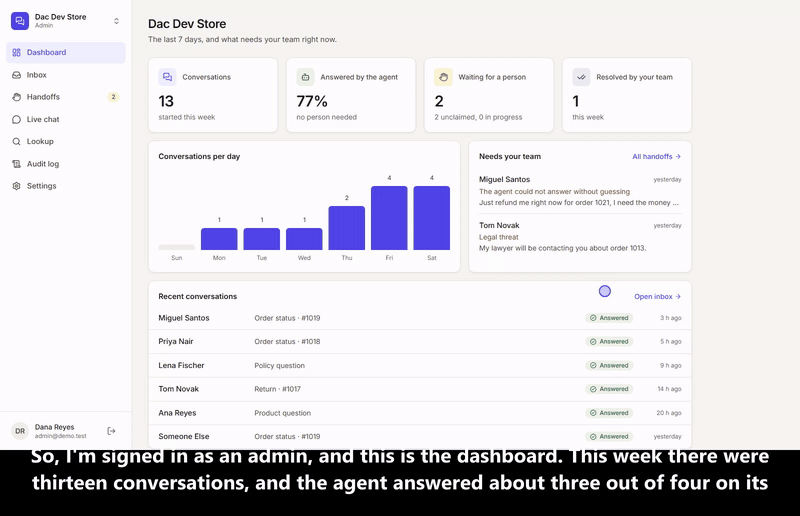

# shop-support-agent

[](https://github.com/Exalt24/shop-support-agent/actions/workflows/ci.yml)



*The console on a development store with sample customers. The full three minute walkthrough regenerates from [docs/demo-video.md](docs/demo-video.md).*

A customer-support agent for a Shopify store. It looks up orders and products through the Admin GraphQL API. It answers from the store's own policy file. It hands anything it should not decide to a person. Built as a working proof of the first of the five agents in an e-commerce AI-agent brief: support.

**Register: built, tested and run live against a Shopify development store with sample customers. It runs locally, on one platform (Shopify).** The human handoff produces a ticket-shaped payload. Wiring it to a helpdesk is the next step. Enquiry routing, the chat widget, the Zoho MCP server, the Zia client and the Claude API and watsonx.ai providers are built and tested against stand-in servers. The servers are written from the vendors' saved documentation pages.

## What it does

`SupportAgent.handle(message, email)` runs in a fixed order, and the order is the design:

1. **Escalation floor first.** A legal threat, a chargeback, a safety report or a request for a person is matched in code before the model sees the message. The model also gets a vote (angry, wants a human). It can only add escalations, never remove one.
2. **Triage** (the model): intent, order number, product query. It never sees order data.
3. **Facts** come from Shopify and `policy.md`, never from the model's memory. Orders are **identity-checked**. The email on the message must match the email on the order.
4. **The model writes the wording only.** A grounding guard refuses a reply that contains a figure not in the facts (digits *and* numbers written as words). It refuses a commitment the agent has no authority to make (refund, discount, replacement). It refuses an outcome the facts do not state ("the tracking details were emailed to you").
5. **Anything that fails ends in a person.** That covers a store outage, a model outage and a reply that fails the guard twice. A failed lookup is never reported as "no such order".
6. **Every turn is logged** (`logs/audit.jsonl`): intent, order, decision, escalation reason, steps. Emails are masked.

## Proof

```
./.venv/Scripts/python.exe -m pytest tests -q              # 836 tests, offline (scripted model, stand-in shop, Zoho, Claude API and IBM watsonx.ai; the widget tests drive Chromium and skip without it)
./.venv/Scripts/python.exe tests/mutation_check.py         # 325 mutants: each guard broken on purpose
./.venv/Scripts/python.exe demo.py                         # nine messages, live store + live model
./.venv/Scripts/python.exe demo_memory.py                  # five turns with memory, live store + model + Postgres
./.venv/Scripts/python.exe demo_enquiry.py                 # five enquiries, scripted model + fake Zoho (no live anything)
./.venv/Scripts/python.exe demo_mcp.py                      # the MCP server over stdio against the fake Zoho
```

- **Mutation harness:** each of 325 guards (the original 11, 14 for customer memory, 40 for enquiry routing, lead capture and the Zoho client, 27 for the chat server and widget, 39 for the MCP tools, the Zoho reads and the Zia client, 74 for the Claude API provider, 120 for the watsonx.ai provider) is deleted from the real source. The suite is run. The file is restored byte-exact. All 325 mutants are caught. Six guards each have a test that fails without them. They are the identity check, the throttle-as-HTTP-200 handling, the legal-threat rule, the grounding guard, the number-word check and `status:active` product filtering.
- **Live transcript:** `demo_transcript.md`. Nine messages including three hostile ones (a refund demand, a prompt injection asking for a 50% discount code, a legal threat). 7 answered and 2 escalated. No promise, invented figure or foreign order detail reached a customer. The live runs changed stemming, active products only, unsupported outcomes and number words. Details: [docs/live-runs.md](docs/live-runs.md).
- **Through n8n:** `n8n/workflow.json` (webhook, agent, "needs a person?" branch, handoff ticket, reply) was imported into a real n8n 2.41.6 server. It was called over its webhook with an answered message, a wrong-email message and a legal threat. Regenerate it with `python n8n/build_workflow.py`.

## Customer memory

The agent remembers returning customers. The design is about what memory is **not** allowed to do. It never supplies a fact (orders, prices and tracking are read live every turn). It stores one verified pointer to the last order. Notes go stale. Only the customer's own words are kept. Isolation is forced row level security per store. Staff can read and erase notes. The rules, the proof commands and the live run are in [docs/customer-memory.md](docs/customer-memory.md).

## Enquiry routing and Zoho CRM lead capture (tested against a stand-in Zoho)

It works for a sales site as well as a shop. The agent sorts each enquiry and routes it to an owner queue. With the visitor's explicit yes, it puts the enquiry in Zoho CRM as a Lead, a follow-up Task and a Note. Details, field rules and the vendor citations are in `docs/enquiry-routing.md`. The Zoho pages it relies on are saved in `docs/vendor-contract/`.

- **Same order as above.** The escalation floor runs first. The model then only proposes an intent from a fixed list of seven. Code checks it. Anything unlisted becomes `human_needed`. A routing table in code gives the owner queue and the follow-up. The model can add an escalation, never remove one.
- **Consent is code, not the model.** The agent asks once, in plain words, whether it may pass the visitor's details to the team. Only an explicit yes in the visitor's own message, after the question, counts ("yes but don't share my phone" does not).
- **A lead is only what the visitor wrote.** Name, email and phone are validated. A company is kept only if the visitor named it. Card-like numbers and secrets are dropped. A message with two different emails uses neither. The note is built by code from their words, shortened.
- **One lead per email per tenant per day.** A stable idempotency key stops a retried request from creating twice. A second enquiry the same day adds a Note to the same lead. Nothing is captured on an escalated turn.
- **The CRM never changes the answer.** The reply is final before Zoho is called. A refusal is recorded with the vendor's code. 429 and 5xx are retried with backoff. An expired token is refreshed once. An Australian account is `ZOHO_REGION=au` (`accounts.zoho.com.au`, `www.zohoapis.com.au`).
- **The audit log holds counts and kinds** (intent, queue, consent yes or no, captured yes or no, vendor code), never the visitor's words or email.

```
./.venv/Scripts/python.exe -m pytest tests -q       # tests/test_enquiry.py, test_zoho_crm.py and test_leads_property.py (seeded random worlds with faults)
./.venv/Scripts/python.exe demo_enquiry.py          # transcript in demo_enquiry_transcript.md
```

**Scope and next steps.** Built and tested against a stand-in that follows the saved Zoho pages. The next step is a run against a Zoho account to confirm every field name. One CRM. The ledger and dialogue state are in memory (one process). The Task owner is not set because no saved page names that key. Consent is an English-keyword check. `serve.py` has it (when `ZOHO_*` variables are set). The console does not.

## One chat widget for two websites, a Zoho MCP server and a Zia client (tested against stand-ins)

- **Widget.** One script tag (`data-site`) and vanilla JavaScript in a Shadow DOM, served by `serve.py` for several websites. Each site is a tenant. It has its own theme, greeting, allowed origins, routing table and Zoho settings. Quote requests go to `estimating` on one site and `trade-accounts` on the other. Guards: per-origin CORS, a site key that only selects the tenant, signed conversation ids, per-IP and per-conversation rate limits, size caps and text-only rendering. The yes and no buttons send the same words the consent code already reads. Chromium tests drive both demo sites at 1280 and 360 pixels. [docs/chat-widget.md](docs/chat-widget.md)
- **MCP server.** Five tools over the lead desk and the Zoho client, on the official `mcp` SDK over stdio. Schemas are strict. Credentials come from the environment only. Every write takes `confirm` and an idempotency key. Answers are small. CRM text is returned as data. Zoho hosts its own MCP servers. This one adds tenant routing and consent. [docs/zoho-mcp.md](docs/zoho-mcp.md)
- **Zia Agents client.** The Agent API is documented enough (endpoint, headers, body, answer, OAuth). So a small client with a fake is built from the saved pages. Nothing else is guessed. There are no retries and no error shapes.

```
./.venv/Scripts/python.exe -m pytest tests/test_widget_browser.py tests/test_mcp_stdio.py -q   # Chromium and a child process
./.venv/Scripts/python.exe demo_widget.py                                                      # the two demo sites on :8101 and :8102
```

**Scope and next steps.** Tested against stand-in Zoho and Zia servers and the two demo sites. The limits are in [docs/chat-widget.md](docs/chat-widget.md).

## Claude API and watsonx.ai providers (tested against stand-ins)

`LLM_PROVIDER=anthropic` makes the agent answer with Anthropic's Claude API (model `claude-sonnet-5-5`) instead of Groq. Groq stays the default when nothing is set. It is one switch for every path. The `/support` endpoint, the chat widget backend and the support console all build their model the same way. So the grounding guard and the escalation floor judge a Claude reply exactly as they judge a Groq one. `LLM_PROVIDER=watsonx` answers through IBM watsonx.ai the same way. It is written from IBM's documentation and tested against a stand-in server that follows it. A live run needs `WATSONX_API_KEY` and `WATSONX_PROJECT_ID` (see [docs/watsonx.md](docs/watsonx.md)).

Both are plain HTTP clients with no vendor SDK. Each failure is a named error that ends in a person. That covers a refusal, a cut-off or empty reply, any HTTP error and a dropped connection. The key is kept out of every message. Both are tested against stand-in servers. The status tables, the retry rules and the open items are in [docs/claude-api-provider.md](docs/claude-api-provider.md) and [docs/watsonx.md](docs/watsonx.md).

```
LLM_PROVIDER=anthropic ANTHROPIC_API_KEY=... ./.venv/Scripts/python.exe -m uvicorn serve:app --port 8008
LLM_PROVIDER=watsonx WATSONX_API_KEY=... WATSONX_PROJECT_ID=... ./.venv/Scripts/python.exe -m uvicorn serve:app --port 8008
./.venv/Scripts/python.exe -m pytest tests/test_anthropic_llm.py tests/test_anthropic_chat_path.py -q   # 142 tests against the Claude stand-in
./.venv/Scripts/python.exe -m pytest tests/test_watsonx_llm.py tests/test_watsonx_chat_path.py -q      # 211 tests against the IBM stand-in
./.venv/Scripts/python.exe tests/mutation_check.py "Claude API"                                         # 74 mutants for the Claude provider
./.venv/Scripts/python.exe tests/mutation_check.py "watsonx"                                            # 120 mutants for the watsonx provider
```

## The support console (login, roles, many stores)

A web console around the same engine. A team can use it, and a new store is a new row rather than a new build. `console_api/` (FastAPI) holds the rules. `console_web/` (Next.js) is the screen.

Sign in with email and password as an **admin** (everything for a store, the audit log, the policy editor) or an **agent** (inbox, handoffs, live chat, lookup). One person can belong to several stores. Tenant isolation is Postgres row level security, enabled and forced. The API connects as a role that cannot bypass it. Roles, pages, login rules, the demo logins and how to point it at another store are in [docs/support-console.md](docs/support-console.md).

```
docker run -d --name support-console-pg -e POSTGRES_PASSWORD=localsuper -e POSTGRES_DB=console -p 54931:5432 postgres:17
./.venv/Scripts/python.exe -m console_api.migrate --reset        # schema, roles, forced RLS
./.venv/Scripts/python.exe -m console_api.seed                   # demo stores, two logins, a week of conversations
CONSOLE_ALLOWED_ORIGINS=http://localhost:3100 ./.venv/Scripts/python.exe -m uvicorn console_api.main:app --port 8010
cd console_web && npm install && npx next dev --port 3100        # then open http://localhost:3100
```

```
./.venv/Scripts/python.exe -m pytest tests_console -q             # 63 tests: isolation, roles, login, the API, customer memory
./.venv/Scripts/python.exe tests_console/mutation_check.py        # 22 mutants: each database rule broken on purpose
cd console_web && node tests/e2e.js                               # 37 browser checks at 1280 and 390, both roles
```

Run the engine and console suites as two commands, not one. Two `conftest.py` files collide. The mutation harness rebuilds the local `console` database. Reseed afterwards and run it only against that local database.

## Scope and next steps

- The console runs locally. Session lockout counters are in memory (one process). A shared store is next.
- The guard checks figures, a list of commitment phrases and unsupported outcomes. Wording-level claims beyond those patterns rely on the prompt and on human review of escalations.
- Policy retrieval is word overlap over a handful of sections, which fits this size. A vector store is the step for a larger knowledge base.
- Out-of-scope messages are escalated rather than answered. That is the conservative choice. It produces more human work than a looser agent.
- Zoho CRM is the one CRM, tested against a stand-in server. Klaviyo, Gorgias, Zendesk, HubSpot, Salesforce and the ad platforms are possible next connectors.
- **Memory.** API and agent only. A console screen is next. It costs one extra model call per answered turn. The live run showed a stored preference nudging a reply toward a mild promise, so the guard stays layered with human review ([docs/customer-memory.md](docs/customer-memory.md)).

## Run it

```
python -m venv .venv && ./.venv/Scripts/python.exe -m pip install -r requirements.txt
# keys: GROQ_API_KEY, SHOPIFY_SHOP, SHOPIFY_ACCESS_TOKEN in the environment (or the saved secret files, see agent/config.py)
# for Claude or IBM watsonx.ai instead of Groq: LLM_PROVIDER=anthropic and ANTHROPIC_API_KEY, or LLM_PROVIDER=watsonx, WATSONX_API_KEY and WATSONX_PROJECT_ID
./.venv/Scripts/python.exe seed_fulfillment.py              # marks one dev-store order shipped with tracking
SUPPORT_AGENT_KEY=demo-key ./.venv/Scripts/python.exe -m uvicorn serve:app --port 8008
```
