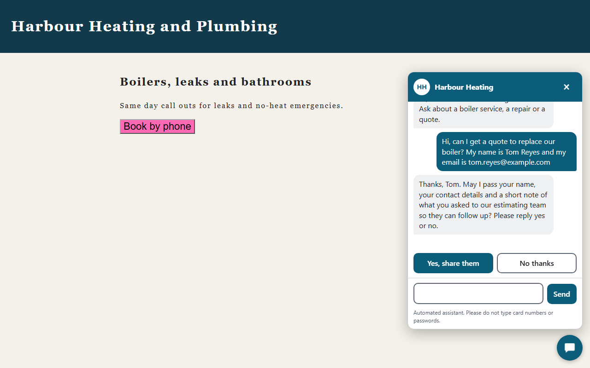
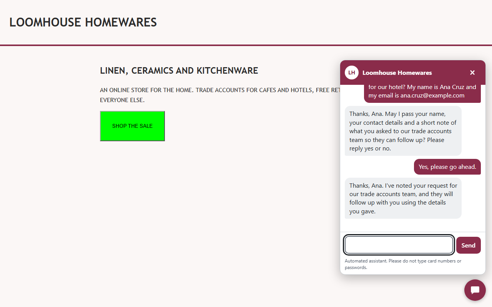
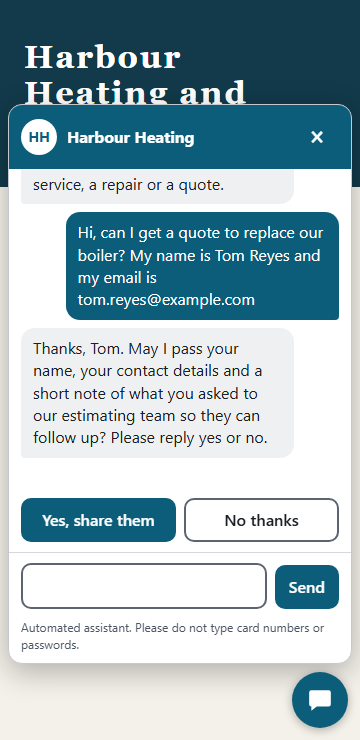

# The embeddable chat widget, for two websites

**Register: built and tested against fakes only.** The model is a keyword script, there is no shop behind it and Zoho CRM is an in-process fake, one per site. Nothing is hosted, no live Zoho account was used and no visitor has ever typed into it. Two invented demo sites (a plumbing and heating company, an online homewares store) stand in for two real ones.

One script tag puts a chat on a page. The same server serves both sites: each site is a **tenant** with its own look, greeting, allowed origins, routing table (which kind of enquiry goes to which owner queue) and Zoho settings. The conversation logic is the existing enquiry desk from [enquiry-routing.md](enquiry-routing.md); the widget adds the front end and the guards a public endpoint needs.



## Install

```html
<script src="https://chat.example.com/widget/widget.js" data-site="pk_harbour_demo_01" async></script>
```

`data-site` is a public key. It selects a tenant and nothing else. `data-api` can name a different server. The tenants file (`widget/demo/tenants.demo.json` is the demo one) is checked at start, and a bad file stops the server: a wildcard origin, a colour that is not `#rrggbb`, a queue name with odd characters, a duplicate key.

```json
{"id": "harbour-heating", "site_key": "pk_harbour_demo_01",
 "theme": {"name": "Harbour Heating", "initials": "HH", "primary": "#0b5d7a", "on_primary": "#ffffff"},
 "greeting": "Hi, I'm the Harbour Heating assistant. ...",
 "allowed_origins": ["http://127.0.0.1:8101"],
 "routing": {"sales_enquiry": "sales", "quote_request": "estimating", "service_request": "dispatch"},
 "assignment_rules": {"estimating": "LAR-HARBOUR-ESTIMATING"},
 "zoho": "harbour"}
```

Run it with `CHAT_TENANTS_FILE`, `CHAT_SIGNING_KEY` (at least 32 characters) and one `ZOHO_<KEY>_CLIENT_ID`, `_CLIENT_SECRET`, `_REFRESH_TOKEN` set per tenant, read at start so a missing one stops the server before a visitor arrives. Without `CHAT_TENANTS_FILE`, `serve.py` serves exactly what it did before.

## What the two sites do differently

The same quote request, asked on each site, lands in a different owner queue, in a different fake CRM:

| | Site A, Harbour Heating | Site B, Loomhouse Homewares |
|---|---|---|
| theme | `#0b5d7a`, avatar HH | `#8a2c4a`, avatar LH |
| `quote_request` goes to | `estimating` (assignment rule `LAR-HARBOUR-ESTIMATING`) | `trade-accounts` (`LAR-LOOMHOUSE-TRADE`) |
| `service_request` goes to | `dispatch` | `customer-care` |
| visitor is told | "our estimating team" | "our trade accounts team" |



## The server guards

`POST /api/chat/message` runs these in this order. Each is its own function with its own test, and each has a mutant in `tests/mutation_check.py` that the suite turns red.

| # | Guard | What it stops |
|---|---|---|
| 1 | Origin must belong to some tenant, else 403 with no CORS headers at all | a page on any other website using the chat |
| 2 | Per-IP rate limit (30 a minute), 429 with `Retry-After` | one address flooding it. `X-Forwarded-For` counts only with `CHAT_TRUST_PROXY=1`, and then only its last entry |
| 3 | `Content-Type: application/json`; a declared length over 8192 bytes is refused unread; a chunked body is cut off at the cap | memory exhaustion |
| 4 | Strict body: `site`, `message` (1 to 1000 characters), optional `conversation_id`, no other field | junk and probing. The 400 is one fixed code and echoes nothing |
| 5 | The site key picks the tenant, and the request must then come from that tenant's origins | site A's page quoting site B's key |
| 6 | The conversation id is one this server signed for this tenant (HMAC-SHA256 over tenant, 128 random bits and the time, 24 hours) | attaching to another visitor's conversation, or to another site's |
| 7 | Per-conversation rate limit (8 a minute) | one chat flooding the model |
| 8 | The reply is JSON text with control characters removed and a length cap; the answer carries `Content-Security-Policy: default-src 'none'` and `nosniff`; no cookie is read or set; CORS never allows credentials and never says `*` | markup or terminal escapes reaching a screen |

The widget then draws every string, the visitor's and the server's, as a text node. It never calls `innerHTML`, `document.write` or `eval`, and a test fails if the script ever contains one.

**Consent buttons.** When the server says `awaiting_consent`, two buttons appear. They send the plain sentences "Yes, please go ahead." and "No, thanks." through the same route as typed text, so the existing consent code in `agent/enquiry.py` is the only thing that decides what counts as a yes. Typing "yes" works the same way, and so does typing something else, in which case the buttons stay and the agent says it has not passed anything on.

## Keyboard, screen reader and small screens

- Launcher and panel are real buttons and a `role="dialog"` with an accessible name. Focus moves into the message box on open, to the Yes button when the question appears, and back to the launcher on Escape or Close.
- Replies land in a `role="log"` region with `aria-live="polite"`, and every bubble starts with a visually hidden "You said:" or "Harbour Heating said:". Controls are at least 44 by 44 pixels. Animation runs only when the visitor has not asked for reduced motion.
- Shadow DOM keeps the page's CSS out. The demo pages carry deliberately hostile rules (hot pink and lime buttons, a Comic Sans rule on every div, `* { text-transform: uppercase }`) to show it.



## What the browser tests do

`tests/test_widget_browser.py` starts the real server (uvicorn on a free port), both demo sites and one stranger origin, and drives them in Chromium with Playwright. It checks: site A routes a quote, the question appears, nothing is in the CRM before the yes, and after the Yes button the fake Zoho for A holds the lead, a task with A's assignment rule and a note while B's CRM was never called; site B sends the same kind of enquiry to a different queue; the No button sends nothing; a page on an unlisted origin gets no launcher and its fetch is blocked, and the server answers it 403; an HTML injection attempt is drawn as text, runs nothing and creates no element; each site gets its own colour whatever the page's CSS says; keyboard order, focus and Escape; reduced motion; and at 360 pixels the panel fits with no sideways scroll and 44 pixel targets.

Two real bugs showed up while writing them, and the tests now pin both. The page's `* { text-transform: uppercase }` reached the widget, because inherited properties cross a shadow boundary: the wrapper inside now starts with `all: initial`. And the consent buttons took room from the message list and cut the question off: the list is scrolled back after they appear. The screenshots above were taken after both fixes and read.

Without Chromium these tests skip, so a laptop without a browser still runs the rest. CI installs Chromium and sets `SHOP_SUPPORT_REQUIRE_BROWSER=1`, which turns a skip into a failure.

## Proof

```
./.venv/Scripts/python.exe -m pytest tests/test_chat_api.py tests/test_chat_guard.py tests/test_tenants.py -q   # the server half, no browser
./.venv/Scripts/python.exe -m playwright install chromium                                                          # once
./.venv/Scripts/python.exe -m pytest tests/test_widget_browser.py -q                                              # both sites in Chromium
WIDGET_SCREENSHOT_DIR=docs ./.venv/Scripts/python.exe -m pytest tests/test_widget_browser.py -q                    # retake the screenshots
./.venv/Scripts/python.exe tests/mutation_check.py chat                                                            # the widget guards broken on purpose
./.venv/Scripts/python.exe demo_widget.py                                                                          # the two demo sites on :8101 and :8102
```

## Honest limits

- **Fakes only.** A scripted model and a fake Zoho. The first live run is the first real test of the model's triage and of every Zoho field name.
- **Not hosted.** Nothing serves it anywhere. The demo pages point at `127.0.0.1`.
- **No analytics, no transcript storage, no cookies.** The conversation id lives in the page's memory, so a reload starts a new chat. Dialogue state and rate limits are in memory in one process: a restart forgets them, and two processes would each keep their own counts.
- **The signing key is a single secret.** Changing it ends every open conversation. There is no rotation and no revocation list.
- **The public site key is not a secret and not an access control.** The origin check is what keeps another site out, and it only holds against browsers: a script that sets its own `Origin` header can still call the endpoint, and the rate limits and size caps are what bound that.
- **A host page can still break the widget.** A strict `Content-Security-Policy` that does not allow the script or the fetch will block it, and the widget then does nothing and says so in the console.
- **English only**, fixed dialogue templates, a keyword consent check. Screen reader support was reasoned from the markup and checked by role and label queries in Chromium; it was not tested with NVDA, JAWS or VoiceOver.
- The widget has no file upload, no typing indicator from the server, no human handoff screen. An escalated turn is answered with the agent's handoff text.
